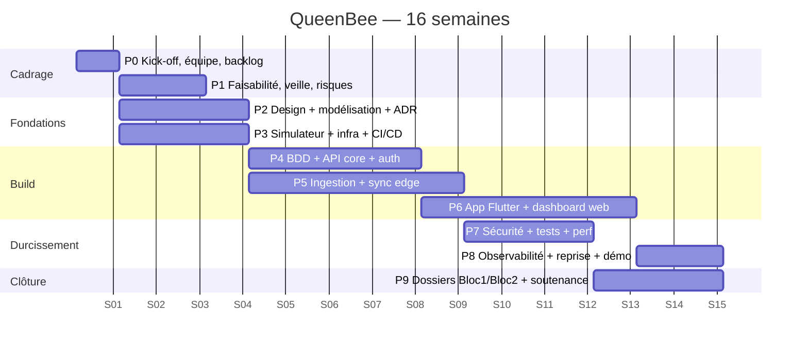
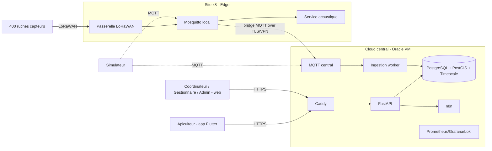
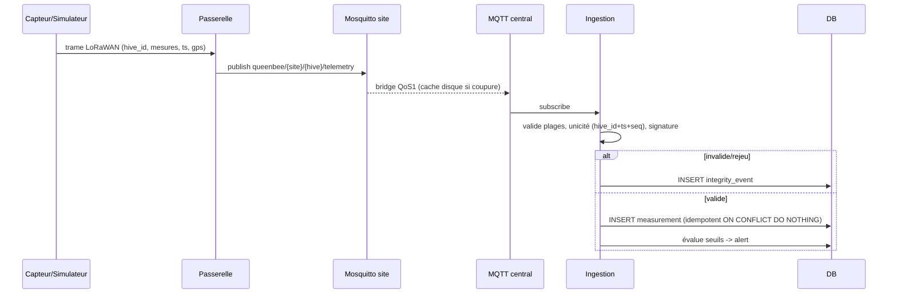
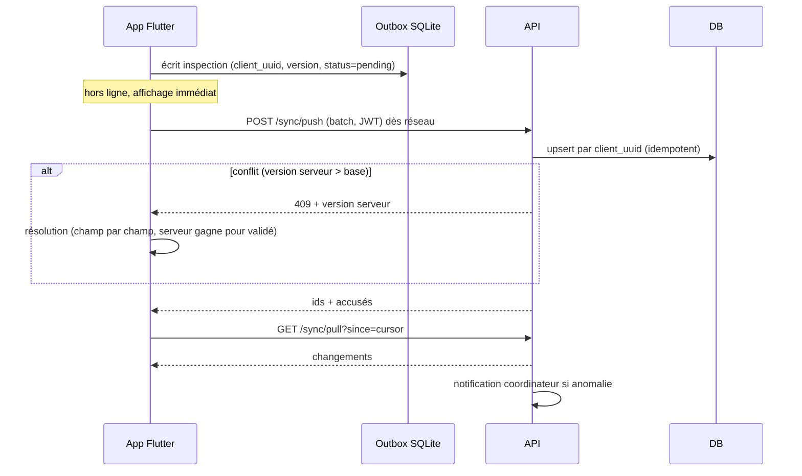
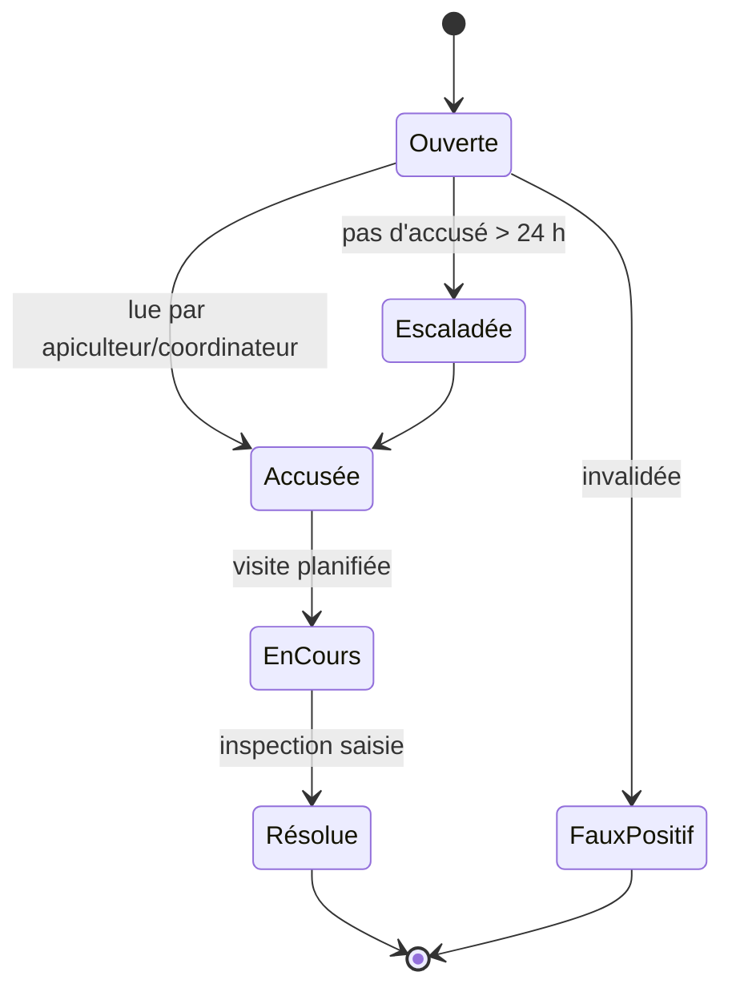
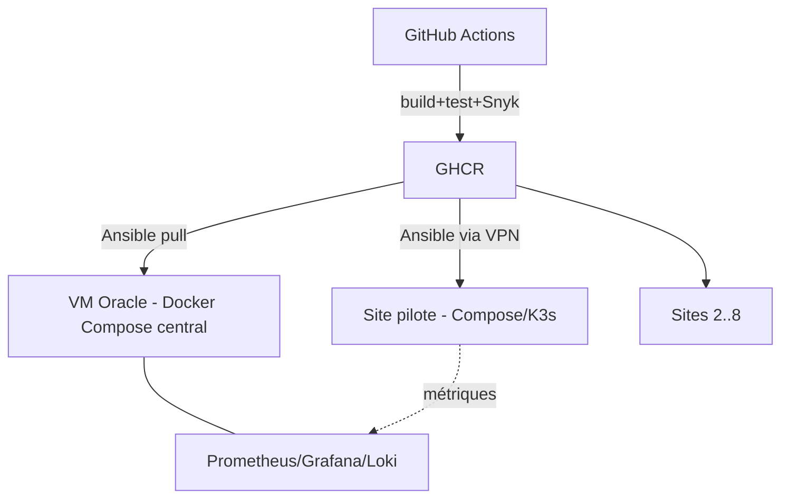
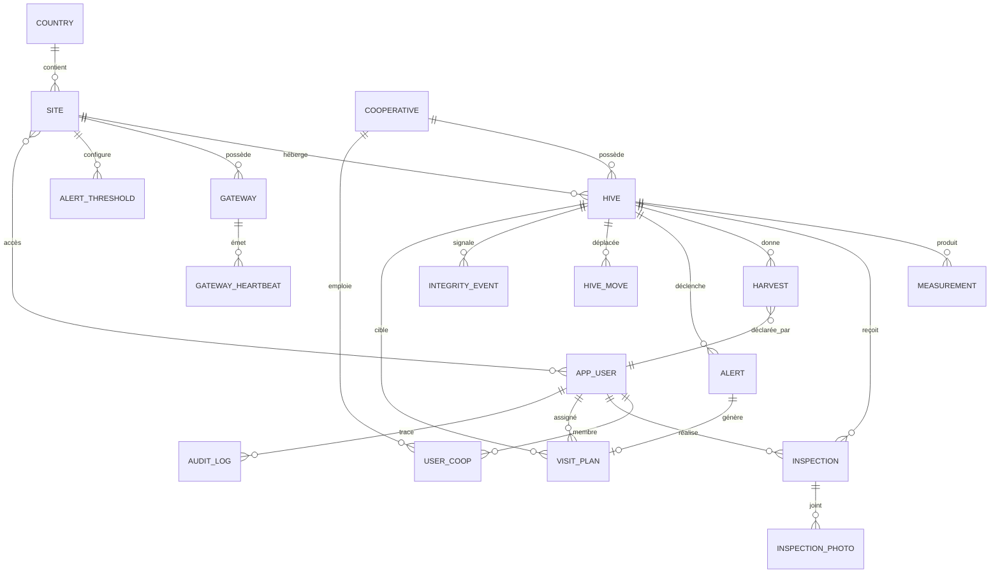
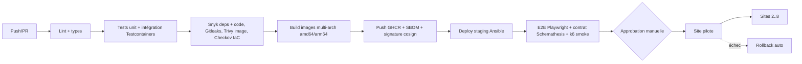
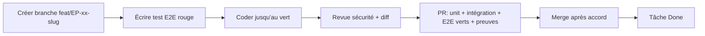

# ROADMAP QUEENBEE — Spécialité Développement (DevOps)

Source : `cahier de charge.md`. Durée : 16 semaines de jalons (S1–S16), sprints de 2 semaines. Équipe : à renseigner.
Règle git : jamais de dev sur `main`. Branches `feat|fix|refactor|test/<slug>`. PR vers `main`, merge seulement après accord.

---

## 1. Stack recommandée et raisons

| Couche | Choix | Raison | Alternative écartée |
|---|---|---|---|
| App terrain (mobile) | **Flutter** + Drift (SQLite) + Riverpod | Offline-first natif, un code Android/iOS, bon sur appareils bas de gamme, QR code et caméra matures. Compétence Flutter déjà présente (projet Zolya). | React Native : bridge plus lourd, sync offline moins standard |
| Dashboard web admin/coordinateur | **Next.js 15 (App Router) + TypeScript + Tailwind + shadcn/ui** | Démontre C2.3 (front-end). SSR utile pour la landing publique (SEO). Composants accessibles (Radix). | Vue/Angular : pas de gain ici |
| API | **FastAPI (Python 3.12) + Pydantic v2 + SQLAlchemy 2 + Alembic** | Même langage que Data (ML, ETL) → moins de friction. OpenAPI auto = contrat d'interface (C2.4). Async, léger en RAM. | Node/Express : valide aussi, mais duplique les modèles avec Data |
| BDD | **PostgreSQL 16 + PostGIS + TimescaleDB** | Imposé : Postgres + PostGIS. Timescale = séries temporelles (hypertables, compression, rétention) pour 38 400 mesures/jour. | InfluxDB : second moteur à exploiter |
| Broker | **MQTT : Eclipse Mosquitto** (site, bridge) + **EMQX ou Mosquitto** (central) | Déjà requis par les capteurs ; persistance + QoS 1 ; bridge site→central gère les coupures. Aucun composant en plus. | RabbitMQ : composant supplémentaire |
| Edge (passerelle) | **Docker Compose** par défaut ; **K3s** si ≥ 2 Go RAM | K3s ≈ 500 Mo au repos : trop pour les passerelles modestes. Même images dans les deux modes. | K3s partout |
| Calcul acoustique edge | Service Python (NumPy/SciPy, FFT) en conteneur | Seul un vecteur de features (~8 octets) part en radio. | Envoi audio brut : interdit (§6.4) |
| Conteneurs / registry | Docker + **GHCR** | Gratuit, intégré à GitHub Actions. | |
| CI/CD | **GitHub Actions** + **Snyk** (deps, conteneurs, IaC) + Trivy + Gitleaks | Porte de sécurité obligatoire. | GitLab CI |
| IaC | **Ansible** (sites, central) + **Terraform** (VM Oracle Cloud) | Ansible recommandé par le CDC ; Terraform pour le provisioning cloud reproductible. | |
| Reverse proxy | **Caddy** (TLS auto) | Config minimale, TLS 1.3 par défaut. | Nginx/Traefik |
| Observabilité | **Prometheus + Alertmanager + Grafana + Loki + node_exporter/cAdvisor** | Imposé (Prometheus+Grafana). Loki = logs légers. | ELK : trop lourd pour 14 Go |
| Auth | JWT court (15 min) + refresh rotatif + **TOTP MFA** + **argon2id** + RBAC 4 rôles | Exigence UC-T01. Offline long : refresh de 30 j stocké chiffré. | |
| Automatisation | **n8n** (conteneur) | Imposé ; ≥ 1 workflow d'intégration. | |
| Cartes | Leaflet + OpenStreetMap | Gratuit, léger. | Google Maps |
| Notifications | FCM (push) + SMTP/SendGrid (email) | §10.2. | |
| PDF rapports | WeasyPrint (côté Data) / appel API | Rapport bailleur UC-G02. | |
| Tests | pytest, Testcontainers, Playwright, flutter_test + integration_test, k6, Schemathesis | Couvre unit/intégration/E2E/charge/contrat. | |
| Docs / modélisation | Mermaid (dans le dépôt), Draw.io, OpenAPI, ADR (`docs/adr/`) | Versionnés avec le code, lisibles sans l'auteur (C2.1). | |
| Gestion de projet | GitHub Projects (Kanban) + Milestones | Même outil que le code, traçabilité PR↔tâche. | Jira |

---

## 2. Skills Claude Code à utiliser (caveman toujours actif)

| Phase | Skills | Usage |
|---|---|---|
| Toute session | `caveman`, `verification-before-completion` | Compression tokens ; preuve avant « terminé » |
| Cadrage / design produit | `brainstorming`, `writing-plans`, `design:user-research`, `design:design-system` | Spécifier avant de coder |
| Direction visuelle | `frontend-design`, `taste-skill`, `ui-ux-pro-max`, `bencium-controlled-ux-designer`, `brand-guidelines` | Identité propre QueenBee (apicole, solidaire, Afrique), pas de template IA |
| Maquettes | `figma-implement-design`, outils Figma MCP | Maquettes → code |
| Mobile Flutter | `flutter-animations`, `mobile-native`, `composition-patterns` (principes) | Animations, architecture composants |
| Web Next.js | `react-best-practices`, `composition-patterns`, `web-design-guidelines`, `design:accessibility-review` | Perf et a11y WCAG 2.2 AA |
| Données / graphes | `dataviz`, `artifact-diagramming` | Charts, diagrammes |
| Architecture | `engineering:architecture`, `engineering:system-design` | ADR, choix argumentés |
| Dev | `test-driven-development`, `investigate-first`, `systematic-debugging`, `surgical-patch`, `safe-refactor`, `migration` | Cycle de dev |
| Sécurité | `security-audit`, `security-review`, agent `security-auditor` | Revue ciblée à chaque tâche |
| Qualité | `requesting-code-review`, `receiving-code-review`, `code-review`, `simplify`, agents `reviewer`, `qa-e2e`, `ui-ux-checker` | Revue de diff, E2E |
| Parallélisme | `dispatching-parallel-agents`, `subagent-driven-development`, `using-git-worktrees` | Sous-tâches indépendantes |
| Déploiement | `engineering:deploy-checklist`, `engineering:incident-response`, `engineering:testing-strategy` | Release, reprise |
| SEO (landing seule) | `seo-audit`, `schema`, `ai-seo`, agent `seo-auditor` | Pages publiques uniquement |
| Contenu | `copywriting`, `copy-editing`, `design:ux-copy` | Textes UI simples, FR (et langues locales) |
| Docs / dossier | `engineering:documentation`, `markdown-to-pdf`, `caveman-commit` | DCT, README, commits |
| Fin de feature | `finishing-a-development-branch` | PR |

---

## 3. Vue d'ensemble : phases et calendrier



| Phase | Semaines | Sprint | Sortie principale |
|---|---|---|---|
| P0 Kick-off | S1 | — | Équipe, dépôt, GitHub Projects, backlog initial |
| P1 Faisabilité & veille | S1–S3 | 0 | Étude faisabilité, matrice risques, plan de veille (C1.1, C1.2) |
| P2 Design & modélisation | S2–S4 | 0–1 | UML, MCD/MLD, maquettes, design system, ADR |
| P3 Simulateur & infra | S2–S4 | 0–1 | Simulateur MQTT, VM Oracle, CI/CD squelette |
| P4 BDD & API core | S4–S7 | 1–2 | Schéma migré, auth, CRUD, OpenAPI |
| P5 Ingestion & sync | S4–S8 | 1–2 | Ingestion MQTT, outbox, bridge site→central, edge |
| P6 Apps | S6–S11 | 2–4 | App Flutter offline, dashboard web |
| P7 Sécurité/tests/perf | S10–S13 | 4–5 | Pentest ciblé, E2E, charge, conformité |
| P8 Obs/reprise/démo | S12–S14 | 5 | Dashboards, panne chronométrée, démo déployée |
| P9 Dossiers & soutenance | S12–S16 | 5 | PDF Bloc 1/2, slides, soutenance |

---

## 4. Processus AVANT le code

### 4.1 Cadrage et gestion de projet (Bloc 1)
- **Méthode** : Scrum léger, sprints 2 sem., daily 15 min, synchro Lun (planning) / Mer (technique) / Ven (démo).
- **Outils** : GitHub Projects (colonnes Backlog / Ready / In progress / Review / Done), Milestones = sprints, labels `area:*` `type:*` `prio:*`.
- **Priorisation** : MoSCoW + score ICE sur le backlog.
- **Definition of Ready** : critères d'acceptation, UC liés, estimation, dépendances Data/Cyber identifiées.
- **Definition of Done** : branche conforme à §5.2b, **test E2E de la tâche vert en CI (§5.4b)**, tests verts, revue approuvée, Snyk sans critique, doc mise à jour, déployé en staging, a11y vérifiée si UI.
- **Registre des risques** (matrice probabilité × impact, 4×4) :

| ID | Risque | Proba | Impact | Score | Mesure |
|---|---|---|---|---|---|
| R1 | Simulateur en retard bloque Data/Cyber | 3 | 4 | 12 | Version minimale S2, enrichie ensuite |
| R2 | Échec déploiement site isolé | 3 | 4 | 12 | Pilote d'abord + rollback testé |
| R3 | Passerelle trop faible pour K3s | 3 | 3 | 9 | Mode Compose |
| R4 | Compétence front-end hors périmètre DevOps | 2 | 3 | 6 | Accord tuteur S2 |
| R5 | Équipe peu disponible | 3 | 3 | 9 | Capacité réelle chiffrée S1 |
| R6 | Fuite de données bénéficiaires | 2 | 4 | 8 | Chiffrement, RBAC, minimisation |
| R7 | Conflits de sync hors-ligne | 3 | 3 | 9 | Stratégie de résolution + tests |
| R8 | Ressources VM limitées (14 Go) | 2 | 3 | 6 | Dimensionnement frugal |

- **Budget** : outils gratuits (GitHub, Oracle Free/école, OSS). Coût = heures équipe ; suivi `prévu vs réalisé` en tableur/Projects.
- **KPI projet** (revus chaque vendredi, seuil → action) : vélocité, burndown, % déploiements réussis (>95 %), couverture tests (≥ 80 % API), vulnérabilités critiques (0), lead time PR (< 2 j), écarts planning (> 15 % → replanifier).
- **Communication** : démo fin de sprint devant l'équipe pédagogique (rôle BeeAfrica), compte rendu écrit, journal des écarts.
- **Gestion du changement** : guide utilisateur illustré, QR code, formation courte, retour d'usage via simulateur de profils (assidu/régulier/occasionnel).

### 4.2 Étude de faisabilité (C1.1)
Livrer : recueil de besoins (coordinateur, admin, Cyber, Data), contraintes (réseau, solaire, RGPD, calendrier), ROI avec hypothèses (heures d'automatisation vs visites évitées −25 %), décision conditionnelle. Annexes A1–A4.

### 4.3 Veille technologique (C1.2)
Sujets : edge/offline sync, MQTT bridge, TimescaleDB, K3s vs Compose, DevSecOps/Snyk, n8n, LoRaWAN, éco-conception. Outils : Feedly/RSS, GitHub releases, Google Alerts, newsletters (CNCF, Postgres Weekly). Fréquence : 1 h/semaine, tri par pertinence, diffusion Slack. Fournir ≥ 2 comptes rendus dont 1 FR sur sources EN. Tableau comparatif concurrents : Arnia, BeeHero, Hive-Tech, 3Bee, Apis Prime.

### 4.4 Exigences non fonctionnelles chiffrées
API p95 < 500 ms · sync < 2 min / jour de données · déploiement réussi > 95 % · couverture ≥ 80 % · 0 vuln critique · LCP ≤ 2,5 s (landing) · app APK < 30 Mo · RTO < 8 h / RPO < 24 h (démo chronométrée).

### 4.5 Accessibilité (exigences rédigées)
RGAA 4.1 / WCAG 2.2 AA : contraste ≥ 4,5:1, cibles tactiles ≥ 48 dp, labels, navigation clavier web, lecteurs d'écran (TalkBack/VoiceOver), `prefers-reduced-motion`, textes simples FR (+ i18n prêt pour langues locales), icônes + texte, saisie minimale, QR code. Audit : axe-core + test manuel TalkBack, rapport en annexe.

### 4.6 Numérique responsable (exigences rédigées)
Acoustique traitée en edge (~8 octets) · échantillonnage adaptatif · compression + rétention Timescale · images WebP/redim côté mobile · pagination et cache HTTP (ETag) · conteneurs minimaux (distroless/alpine) · arrêt auto VM de test hors séance · mesure CPU/RAM/énergie par service (cAdvisor) · budget poids page ≤ 200 Ko JS.

### 4.7 Design (direction propre à QueenBee)
- **Identité** : chaleureuse, terre/miel, sérieuse pour bailleurs. Palette : miel `#E8A317`, ambre foncé `#8A5A00`, terre `#3B2A1A`, vert feuille `#4C7A3A`, crème `#FBF5E6`, alerte rouge `#C0392B`. Contrastes validés AA.
- **Typo** : Inter (UI), Fraunces (titres). Échelle 12/14/16/20/28/40.
- **Tokens** : couleurs, espacement 4 px, rayons 8/16, ombres, durées motion (150/250 ms), exportés en CSS vars (web) et `ThemeData` (Flutter).
- **Principes** : une action principale par écran, pictogrammes + mots, grands boutons, états loading/erreur/vide/hors-ligne toujours dessinés, bannière « hors ligne / N éléments à synchroniser ».
- **Écrans mobile** (apiculteur) : Login, Mes ruches (liste + carte + QR), Détail ruche (poids, score santé, graphe 7 j), Nouvelle inspection (stepper 4 étapes + photo), Alertes, Récolte, Sync/Profil.
- **Écrans web** : Coordinateur (liste risques, carte, planning visites, validation récoltes) ; Gestionnaire (KPIs, comparaison sites, rapport PDF) ; Admin (utilisateurs/rôles, seuils, vue DevOps déploiements, vue Cyber journaux).
- **Livrables design** : design system Figma, 12 maquettes basse + haute fidélité, parcours UC-A01/A02/A03/C01/C02/G01/G02/AD01, tests utilisateurs (5 personnes, rapport).

### 4.8 Modélisation (UML/BPMN)
Outil : Mermaid dans `docs/` + Draw.io. Diagrammes à produire : contexte, cas d'utilisation, composants, déploiement, séquence (sync, ingestion, alerte), états (cycle d'une alerte, d'une inspection), activité/BPMN (déclaration de récolte), classes/ER.

**Contexte système**


**Séquence — ingestion IoT (UC-T02)**


**Séquence — sync offline (UC-A01)**


**États d'une alerte**


**Déploiement**


### 4.9 Modèle de données et base complète
Principes : UUID v7, `timestamptz` UTC, soft delete, `created_at/updated_at/version`, audit trail, RLS PostgreSQL par site, chiffrement colonnes PII (pgcrypto), minimisation.

**MCD (relations)**


**DDL (PostgreSQL 16 + PostGIS + TimescaleDB)**
```sql
CREATE EXTENSION IF NOT EXISTS postgis;
CREATE EXTENSION IF NOT EXISTS timescaledb;
CREATE EXTENSION IF NOT EXISTS pgcrypto;
CREATE EXTENSION IF NOT EXISTS citext;

CREATE TYPE user_role AS ENUM ('beekeeper','coordinator','manager','admin');
CREATE TYPE alert_type AS ENUM ('swarming','weak_colony','thermal_stress','dead_colony','heatwave','offline_sensor','gateway_offline','hive_moved','integrity','radio_jamming');
CREATE TYPE alert_status AS ENUM ('open','acknowledged','in_progress','resolved','escalated','false_positive');
CREATE TYPE severity AS ENUM ('info','warning','critical');
CREATE TYPE harvest_status AS ENUM ('declared','validated','flagged');
CREATE TYPE visit_status AS ENUM ('planned','done','cancelled');
CREATE TYPE integrity_kind AS ENUM ('out_of_range','replay','bad_signature','duplicate','unknown_sensor');

CREATE TABLE country (
  code char(2) PRIMARY KEY, name text NOT NULL, data_residency text
);

CREATE TABLE site (
  id uuid PRIMARY KEY DEFAULT gen_random_uuid(),
  code text UNIQUE NOT NULL,                -- ex SN-CASA
  name text NOT NULL,
  country_code char(2) NOT NULL REFERENCES country(code),
  location geography(Point,4326) NOT NULL,
  climate_profile text,
  created_at timestamptz NOT NULL DEFAULT now(),
  updated_at timestamptz NOT NULL DEFAULT now()
);
CREATE INDEX site_loc_gix ON site USING gist(location);

CREATE TABLE cooperative (
  id uuid PRIMARY KEY DEFAULT gen_random_uuid(),
  name text NOT NULL, site_id uuid NOT NULL REFERENCES site(id),
  active boolean NOT NULL DEFAULT true,
  created_at timestamptz NOT NULL DEFAULT now()
);

CREATE TABLE app_user (
  id uuid PRIMARY KEY DEFAULT gen_random_uuid(),
  email citext UNIQUE NOT NULL,
  password_hash text NOT NULL,              -- argon2id
  full_name_enc bytea NOT NULL,             -- pgcrypto
  phone_enc bytea,
  role user_role NOT NULL,
  mfa_secret_enc bytea, mfa_enabled boolean NOT NULL DEFAULT false,
  failed_attempts int NOT NULL DEFAULT 0, locked_until timestamptz,
  consent_at timestamptz,                   -- RGPD
  locale text NOT NULL DEFAULT 'fr',
  active boolean NOT NULL DEFAULT true,
  created_at timestamptz NOT NULL DEFAULT now(),
  updated_at timestamptz NOT NULL DEFAULT now(),
  CHECK (role = 'beekeeper' OR mfa_enabled)    -- MFA obligatoire rôles privilégiés (activée avant usage)
);

CREATE TABLE user_site (
  user_id uuid REFERENCES app_user(id) ON DELETE CASCADE,
  site_id uuid REFERENCES site(id) ON DELETE CASCADE,
  PRIMARY KEY (user_id, site_id)
);
CREATE TABLE user_cooperative (
  user_id uuid REFERENCES app_user(id) ON DELETE CASCADE,
  cooperative_id uuid REFERENCES cooperative(id) ON DELETE CASCADE,
  PRIMARY KEY (user_id, cooperative_id)
);

CREATE TABLE refresh_token (
  id uuid PRIMARY KEY, user_id uuid NOT NULL REFERENCES app_user(id) ON DELETE CASCADE,
  family_id uuid NOT NULL, token_hash text NOT NULL,
  device_id text, expires_at timestamptz NOT NULL, revoked_at timestamptz
);

CREATE TABLE gateway (
  id uuid PRIMARY KEY DEFAULT gen_random_uuid(),
  site_id uuid NOT NULL REFERENCES site(id), serial text UNIQUE NOT NULL,
  cert_fingerprint text, last_seen timestamptz, mode text DEFAULT 'online'
);
CREATE TABLE gateway_heartbeat (
  gateway_id uuid NOT NULL REFERENCES gateway(id), ts timestamptz NOT NULL,
  cpu_pct real, mem_pct real, battery_pct real, queue_depth int, lora_loss_pct real,
  PRIMARY KEY (gateway_id, ts)
);
SELECT create_hypertable('gateway_heartbeat','ts', chunk_time_interval => interval '7 days');

CREATE TABLE hive (
  id uuid PRIMARY KEY DEFAULT gen_random_uuid(),
  code text UNIQUE NOT NULL,                -- ex SN-CASA-014
  site_id uuid NOT NULL REFERENCES site(id),
  cooperative_id uuid NOT NULL REFERENCES cooperative(id),
  owner_id uuid REFERENCES app_user(id),
  ref_position geography(Point,4326) NOT NULL,
  tolerance_m int NOT NULL DEFAULT 30,
  sensor_key_hash text,                     -- authentification capteur
  qr_token text UNIQUE NOT NULL,
  status text NOT NULL DEFAULT 'active',
  installed_at date, deleted_at timestamptz,
  created_at timestamptz NOT NULL DEFAULT now(), updated_at timestamptz NOT NULL DEFAULT now()
);
CREATE INDEX hive_site_idx ON hive(site_id);
CREATE INDEX hive_pos_gix ON hive USING gist(ref_position);

CREATE TABLE measurement (
  hive_id uuid NOT NULL REFERENCES hive(id),
  ts timestamptz NOT NULL,
  seq int NOT NULL,                         -- compteur anti-rejeu
  position geography(Point,4326),
  weight_kg real, temp_internal_c real, temp_external_c real,
  humidity_pct real, acoustic_activity real, battery_pct real,
  received_at timestamptz NOT NULL DEFAULT now(),
  PRIMARY KEY (hive_id, ts, seq)
);
SELECT create_hypertable('measurement','ts', chunk_time_interval => interval '7 days');
ALTER TABLE measurement SET (timescaledb.compress, timescaledb.compress_segmentby='hive_id');
SELECT add_compression_policy('measurement', interval '30 days');
SELECT add_retention_policy('measurement', interval '3 years');
CREATE MATERIALIZED VIEW measurement_hourly WITH (timescaledb.continuous) AS
  SELECT hive_id, time_bucket('1 hour', ts) AS bucket,
         avg(weight_kg) w_avg, min(weight_kg) w_min, max(weight_kg) w_max,
         avg(temp_internal_c) t_int, avg(humidity_pct) hum, avg(acoustic_activity) ac
  FROM measurement GROUP BY hive_id, bucket;

CREATE TABLE integrity_event (
  id bigserial PRIMARY KEY, hive_id uuid, gateway_id uuid, kind integrity_kind NOT NULL,
  payload jsonb, detected_at timestamptz NOT NULL DEFAULT now()
);

CREATE TABLE alert_threshold (
  id uuid PRIMARY KEY DEFAULT gen_random_uuid(),
  site_id uuid REFERENCES site(id), alert_type alert_type NOT NULL,
  params jsonb NOT NULL,                    -- ex {"drop_kg":0.5,"window_h":2}
  UNIQUE (site_id, alert_type)
);

CREATE TABLE alert (
  id uuid PRIMARY KEY DEFAULT gen_random_uuid(),
  hive_id uuid REFERENCES hive(id), gateway_id uuid REFERENCES gateway(id),
  type alert_type NOT NULL, severity severity NOT NULL,
  confidence real CHECK (confidence BETWEEN 0 AND 1),
  health_score smallint CHECK (health_score BETWEEN 0 AND 100),
  recommendation text, status alert_status NOT NULL DEFAULT 'open',
  detected_at timestamptz NOT NULL DEFAULT now(),
  acknowledged_by uuid REFERENCES app_user(id), acknowledged_at timestamptz,
  resolved_at timestamptz, source text NOT NULL DEFAULT 'rules',   -- rules|ml|infra
  dedup_key text UNIQUE
);
CREATE INDEX alert_status_idx ON alert(status, severity, detected_at DESC);

CREATE TABLE visit_plan (
  id uuid PRIMARY KEY DEFAULT gen_random_uuid(),
  hive_id uuid NOT NULL REFERENCES hive(id), assignee_id uuid NOT NULL REFERENCES app_user(id),
  created_by uuid NOT NULL REFERENCES app_user(id), alert_id uuid REFERENCES alert(id),
  planned_for date NOT NULL, status visit_status NOT NULL DEFAULT 'planned'
);

CREATE TABLE inspection (
  id uuid PRIMARY KEY DEFAULT gen_random_uuid(),
  client_uuid uuid UNIQUE NOT NULL,         -- idempotence sync
  hive_id uuid NOT NULL REFERENCES hive(id), author_id uuid NOT NULL REFERENCES app_user(id),
  inspected_at timestamptz NOT NULL, visual_state text, queen_present boolean,
  behavior text, notes text, anomaly boolean NOT NULL DEFAULT false,
  visit_plan_id uuid REFERENCES visit_plan(id),
  version int NOT NULL DEFAULT 1, synced_at timestamptz,
  created_at timestamptz NOT NULL DEFAULT now(), updated_at timestamptz NOT NULL DEFAULT now()
);
CREATE INDEX inspection_hive_idx ON inspection(hive_id, inspected_at DESC);
CREATE TABLE inspection_photo (
  id uuid PRIMARY KEY DEFAULT gen_random_uuid(),
  inspection_id uuid NOT NULL REFERENCES inspection(id) ON DELETE CASCADE,
  storage_key text NOT NULL, bytes int, sha256 text
);

CREATE TABLE harvest (
  id uuid PRIMARY KEY DEFAULT gen_random_uuid(),
  client_uuid uuid UNIQUE NOT NULL, hive_id uuid NOT NULL REFERENCES hive(id),
  declared_by uuid NOT NULL REFERENCES app_user(id),
  harvested_on date NOT NULL, volume_kg numeric(8,2) NOT NULL CHECK (volume_kg >= 0),
  predicted_kg numeric(8,2), gap_pct numeric(6,2),
  status harvest_status NOT NULL DEFAULT 'declared',
  validated_by uuid REFERENCES app_user(id), validated_at timestamptz,
  version int NOT NULL DEFAULT 1
);

CREATE TABLE hive_move (
  id uuid PRIMARY KEY DEFAULT gen_random_uuid(),
  hive_id uuid NOT NULL REFERENCES hive(id), declared boolean NOT NULL,
  declared_by uuid REFERENCES app_user(id), from_pos geography(Point,4326),
  to_pos geography(Point,4326), valid_from timestamptz, valid_to timestamptz
);

CREATE TABLE sync_cursor (
  user_id uuid, device_id text, last_pulled_at timestamptz, PRIMARY KEY(user_id, device_id)
);

CREATE TABLE deployment (
  id uuid PRIMARY KEY DEFAULT gen_random_uuid(), site_id uuid REFERENCES site(id),
  version text NOT NULL, git_sha text, started_at timestamptz, finished_at timestamptz,
  status text NOT NULL, rollback_of uuid REFERENCES deployment(id), log_url text
);   -- alimente le dashboard DevOps et le KPI > 95 %

CREATE TABLE audit_log (
  id bigserial PRIMARY KEY, ts timestamptz NOT NULL DEFAULT now(),
  actor_id uuid, action text NOT NULL, entity text, entity_id text,
  ip inet, details jsonb
);   -- append-only (REVOKE UPDATE, DELETE)

-- Row Level Security par site
ALTER TABLE hive ENABLE ROW LEVEL SECURITY;
CREATE POLICY hive_site_policy ON hive USING (
  site_id IN (SELECT site_id FROM user_site WHERE user_id = current_setting('app.user_id')::uuid)
  OR current_setting('app.role') IN ('manager','admin')
);
```
Dictionnaire de données : généré depuis le DDL (`docs/data-dictionary.md`), justification des choix (Timescale vs table partitionnée, RLS, UUID) en ADR.

**Résolution de conflits sync** : `client_uuid` + `version`. Règles : serveur gagne si statut `validated` ; sinon fusion champ par champ (`updated_at` le plus récent) ; photos et notes jamais écrasées (ajout). Tests de propriété sur ces règles.

### 4.10 Contrat d'API (OpenAPI 3.1, préfixe `/api/v1`)

| Domaine | Endpoints |
|---|---|
| Auth | `POST /auth/login` · `/auth/mfa/verify` · `/auth/refresh` · `/auth/logout` · `GET /me` |
| Utilisateurs (admin) | `GET/POST /users` · `PATCH /users/{id}` · `POST /users/{id}/roles` · `GET /audit` |
| Sites/coops | `GET /sites` · `GET /sites/{id}/summary` · `GET /cooperatives` |
| Ruches | `GET /hives` (filtres site, risque, bbox) · `GET /hives/{id}` · `GET /hives/{id}/measurements?from&to&bucket` · `POST/PATCH /hives` · `GET /hives/by-qr/{token}` |
| Inspections | `POST /inspections` · `GET /inspections?hive_id` · `POST /inspections/{id}/photos` |
| Récoltes | `POST /harvests` · `GET /harvests?status` · `POST /harvests/{id}/validate` |
| Alertes | `GET /alerts` · `POST /alerts/{id}/ack` · `POST /alerts/{id}/resolve` |
| Visites | `GET/POST /visit-plans` |
| Sync | `POST /sync/push` · `GET /sync/pull?since=` |
| Analytics | `GET /analytics/kpis` · `POST /reports` · `GET /reports/{id}` |
| Ops | `GET /health` · `GET /ready` · `GET /metrics` · `GET /ops/deployments` · `GET /ops/sync-queues` |
| Simulateur | `POST /sim/scenarios/{name}/run` · `GET /sim/status` · `PUT /sim/speed` |

Règles : pagination curseur, `ETag`, erreurs RFC 9457, versionnement, rate limit, idempotency-key sur POST.

**MQTT topics** : `queenbee/{site}/{hive}/telemetry` (QoS1) · `.../status` · `queenbee/{site}/gw/heartbeat` · `queenbee/sim/cmd` · `queenbee/{site}/cmd/config` (rétention).

---

## 5. Processus PENDANT le code

### 5.1 Structure du dépôt (monorepo)
```
queenbee/
├─ apps/
│  ├─ api/            FastAPI (app/, alembic/, tests/)
│  ├─ web/            Next.js (landing publique + dashboard privé)
│  ├─ mobile/         Flutter (lib/, test/, integration_test/)
│  ├─ ingest/         worker MQTT -> DB
│  ├─ edge-acoustic/  extraction features
│  └─ simulator/      moteur scénarios + profils humains
├─ infra/
│  ├─ ansible/ (roles: common, docker, site, central, monitoring)
│  ├─ terraform/ (oracle)
│  ├─ compose/ (central.yml, site.yml, dev.yml)
│  └─ k3s/ (manifests optionnels)
├─ db/ (schema.sql, seeds/, dictionnaire)
├─ n8n/ (workflows exportés .json)
├─ monitoring/ (prometheus rules, grafana dashboards JSON, loki)
├─ docs/ (adr/, diagrams/, openapi.yaml, runbooks/, dossier/)
├─ .github/workflows/ (ci.yml, security.yml, deploy.yml, release.yml)
├─ ROADMAP.md · cahier de charge.md · README.md · CLAUDE.md
```

### 5.2 Gestion des versions
Trunk léger : `main` protégée (PR + 1 revue + CI verte), branches courtes, Conventional Commits (`caveman-commit`), SemVer par tag, CHANGELOG auto. CODEOWNERS par zone. Hooks pre-commit : ruff, black, mypy, eslint, prettier, dart format, gitleaks.

### 5.2b Normalisation des branches (obligatoire, phase ET fonctionnalité)

**Hiérarchie** : `main` (protégée) ← `phase/<NN>-<slug>` (une par phase, optionnelle, intégration) ← `<type>/<epic>-<slug>` (une par fonctionnalité/tâche).

| Niveau | Format | Exemple | Cycle de vie |
|---|---|---|---|
| Phase | `phase/<NN>-<slug>` | `phase/03-simulateur-infra` | Créée au début de phase depuis `main`. PR de phase vers `main` en fin de phase (draft si blocages). |
| Fonctionnalité | `feat/<EP-xx>-<slug>` | `feat/EP-04-ingestion-anti-rejeu` | Depuis la branche de phase (ou `main`). PR vers la branche de phase. |
| Correctif | `fix/<EP-xx>-<slug>` | `fix/EP-05-bridge-reconnect` | Idem |
| Refactor | `refactor/<EP-xx>-<slug>` | `refactor/EP-06-service-layer` | Idem |
| Tests | `test/<EP-xx>-<slug>` | `test/EP-07-e2e-offline-sync` | Idem |
| Docs | `docs/<slug>` | `docs/adr-003-mqtt-bridge` | Idem |
| Infra/CI | `chore/<slug>` ou `ci/<slug>` | `ci/snyk-gate` | Idem |
| Hotfix | `hotfix/<slug>` | `hotfix/jwt-expiry` | Depuis `main`, PR directe |

**Règles**
1. `<slug>` : minuscules, tirets, ≤ 40 caractères, sans accent. `EP-xx` = identifiant d'epic du §5.4.
2. Une branche = une tâche = une PR ; durée de vie ≤ 3 jours ; rebase fréquent sur la branche parente.
3. Aucun commit direct sur `main` ni sur `phase/*` (hook `git-guard` actif) ; jamais de force-push.
4. Nom de PR = Conventional Commit : `feat(ingest): rejette les trames rejouées (EP-04)`. Lien vers l'issue (`Closes #n`).
5. Une PR contient : description, tests exécutés (unit + intégration + **E2E**), preuves (logs/captures), revue sécurité, limites connues.
6. Merge uniquement après CI verte + 1 revue + accord explicite ; stratégie squash pour les features, merge commit pour les PR de phase.
7. Tag SemVer sur `main` en fin de phase (`v0.<phase>.0`). Branche supprimée après merge.
8. Création standard :
```bash
git switch main && git pull
git switch -c phase/04-api-core            # début de phase
git switch -c feat/EP-03-auth-rbac         # début de tâche
```
9. Worktrees (`using-git-worktrees`) pour tâches parallèles sur fichiers distincts ; jamais deux agents sur les mêmes fichiers.
10. Branche de phase fermée seulement quand : tâches finies ou bloquées documentées, régression complète verte, revue sécurité, E2E verts, PR ouverte.

### 5.3 Pipeline CI/CD

Porte : échec si vuln critique/haute non acceptée, couverture < 80 %, E2E rouge. Chaque déploiement écrit dans `deployment` (KPI > 95 %). Rollback testé avant tout déploiement site.

### 5.4 Ordre de réalisation (backlog par epic)
1. **EP-00 Infra socle** : VM Oracle (Terraform), Docker, Caddy TLS, GHCR, CI squelette, secrets (GitHub Secrets/SOPS).
2. **EP-01 Simulateur** (chemin critique S2–S4) : publication MQTT, 1 site → 8 sites, accélération, profils climatiques, comportements humains, scénarios YAML (7 minimum), API run, vérité terrain.
3. **EP-02 BDD** : migrations Alembic, seeds 8 sites/400 ruches/317 users, RLS, Timescale policies.
4. **EP-03 Auth/RBAC** : login, refresh rotatif, TOTP, verrou 5 essais, audit.
5. **EP-04 Ingestion** : validation, anti-rejeu, idempotence, règles de seuil (poids, acoustique, température, immobilité, GPS) → alertes ; contrat avec Data pour score ML.
6. **EP-05 Edge & sync** : Mosquitto site + bridge, cache disque, service acoustique, heartbeat, mode dégradé, métriques file.
7. **EP-06 API métier** : ruches, inspections, récoltes, alertes, visites, analytics, rapports.
8. **EP-07 App Flutter** : Drift, outbox, sync push/pull, QR, caméra, push FCM, i18n, a11y.
9. **EP-08 Dashboard web** : coordinateur, gestionnaire, admin (+ vues DevOps/Cyber).
10. **EP-09 n8n** : workflow notification (alerte critique → FCM/email), workflow export rapport.
11. **EP-10 Observabilité** : dashboards déploiements/sync/incidents, alertes Alertmanager.
12. **EP-11 Reprise** : sauvegarde pg_dump/WAL chiffrée, restauration testée, panne gateway chronométrée.
13. **EP-12 Landing publique** (SEO) : voir §6.4.

### 5.4b Test E2E obligatoire pour chaque tâche

Règle : aucune tâche n'est « Done » sans au moins un test E2E automatisé (parcours affecté, erreurs console, réseau et assertions métier ; un screenshot seul ne prouve rien). Le test s'écrit avant ou avec le code (TDD) sur la même branche `feat/EP-xx-*`, tourne en CI à chaque PR, et sa sortie est jointe à la PR. Bug corrigé = test E2E ou d'intégration de non-régression.

| Epic | Branche type | Test E2E minimal (environnement : stack Compose + simulateur) |
|---|---|---|
| EP-00 Infra | `chore/EP-00-infra-socle` | `terraform apply` + Ansible sur VM vierge → `GET /health` 200 via TLS 1.3, certificat valide, rollback → version précédente servie |
| EP-01 Simulateur | `feat/EP-01-simulateur` | Lancer scénario `essaimage_ruche_014` accéléré ×60 → messages reçus sur le topic MQTT aux horodatages attendus, vérité terrain écrite ; 8 sites ×50 ruches publient |
| EP-02 BDD | `feat/EP-02-schema-db` | Migration up/down sur base vide + seeds → comptes attendus (8 sites, 400 ruches) ; RLS : utilisateur site A ne lit pas site B |
| EP-03 Auth | `feat/EP-03-auth-rbac` | Login → MFA → accès ; 5 mauvais mots de passe → compte verrouillé ; refresh rotatif, réutilisation → révocation famille ; chaque rôle : matrice d'accès (IDOR) |
| EP-04 Ingestion | `feat/EP-04-ingestion` | Simulateur envoie trames valides, rejouées, hors plage, GPS déplacé → mesures en base, rejetées dans `integrity_event`, alerte `hive_moved` ; idempotence sur double envoi |
| EP-05 Edge/sync | `feat/EP-05-edge-bridge` | Couper réseau site 15 min (netem) → 0 perte après reprise, rattrapage 1 jour < 2 min, alerte `gateway_offline` à 15 min |
| EP-06 API métier | `feat/EP-06-api-*` | Parcours UC-C01/C02/G02 par API : alerte → plan de visite → inspection → récolte → validation → PDF généré ; Schemathesis sans 500 |
| EP-07 App Flutter | `feat/EP-07-app-offline` | `integration_test` : mode avion → créer inspection + photo → réactiver réseau → synchronisée, coordinateur notifié ; conflit simulé → résolution attendue |
| EP-08 Dashboard web | `feat/EP-08-dashboard-*` | Playwright : login coordinateur → ruches triées par risque → planifier visite ; gestionnaire → KPI + export PDF ; admin → créer utilisateur, audit tracé ; axe-core 0 violation critique ; erreurs console = 0 |
| EP-09 n8n | `feat/EP-09-n8n-notif` | Alerte critique injectée → workflow déclenché → email/FCM de test reçu (mock) en < 30 s ; workflow exporté rejouable |
| EP-10 Observabilité | `feat/EP-10-observabilite` | Provoquer incident (arrêt conteneur, file saturée) → alerte Alertmanager reçue + panneau Grafana concerné change d'état |
| EP-11 Reprise | `feat/EP-11-reprise` | Détruire la base de test → restaurer depuis sauvegarde → intégrité vérifiée, RPO/RTO chronométrés ; panne passerelle simulée → mode dégradé → reprise |
| EP-12 Landing SEO | `feat/EP-12-landing` | Playwright + Lighthouse CI : meta/canonical/JSON-LD présents, `noindex` sur zones privées, LCP ≤ 2,5 s, 404 correcte, liens non cassés |
| Transverse | `test/e2e-demo-scenario` | Scénario de démo complet de bout en bout (§6.7), exécuté nocturne en CI |

**Exécution** : Playwright (web), `integration_test` + Patrol (mobile), pytest + Testcontainers (backend), simulateur comme source de données unique, `docker compose -f infra/compose/e2e.yml up`. Rapports (HTML, traces, vidéos) archivés en artefacts CI et cités en annexe du dossier. Agent `qa-e2e` lancé à chaque fin de tâche ; `reviewer` + `security-auditor` en parallèle.

**Intégration au flux** :


### 5.5 Normes de code
Python : ruff + mypy strict, couches `routers/ services/ repositories/ schemas/`, injection de dépendances FastAPI, pas de SQL dans les routers. TS : strict, ESLint, composants server par défaut. Dart : `very_good_analysis`, Riverpod, repository pattern. Logs JSON structurés avec `trace_id`. 12-factor, config par env, secrets jamais committés. Revue : checklist (sécurité, a11y, perf, tests, migration réversible).

### 5.6 Stratégie de tests
| Niveau | Outil | Cible |
|---|---|---|
| Unit | pytest, flutter_test, vitest | ≥ 80 % API, règles de seuil à 100 % |
| Intégration | Testcontainers (Postgres+Timescale+Mosquitto) | ingestion, sync, RLS |
| Contrat | Schemathesis sur OpenAPI | pas de 500, schéma respecté |
| E2E | Playwright (web), integration_test (mobile) | UC-A01…UC-AD01 |
| Résilience | scripts coupure réseau (tc/netem) + simulateur | zéro perte, rattrapage < 2 min |
| Charge | k6 | 400 ruches ×24 accéléré, API p95 < 500 ms |
| Sécurité | OWASP ZAP baseline, Snyk, Trivy | 0 critique |
| A11y | axe-core, TalkBack manuel | WCAG 2.2 AA |
| Non-régression | test par bug corrigé | obligatoire |

### 5.7 Sécurité (par couche)
- **Auth** : argon2id, JWT 15 min, refresh rotatif détection de réutilisation, TOTP, verrou 5 essais, device binding.
- **Autorisation** : RBAC côté serveur + RLS Postgres ; test IDOR automatisé par rôle.
- **Entrée/sortie** : Pydantic strict, requêtes paramétrées, échappement, CSP stricte, CORS liste blanche, upload photos (type magique, taille, ré-encodage, antivirus ClamAV optionnel).
- **Transport** : TLS 1.3, HSTS, mTLS ou certificats pour passerelles, VPN WireGuard site-central.
- **Données** : chiffrement au repos (disque + pgcrypto PII), SQLite mobile chiffré (SQLCipher), clé dans Keystore/Keychain, minimisation, consentement, durée de rétention, droit à l'effacement.
- **Capteurs** : signature HMAC par ruche, anti-rejeu `seq`, plages physiques, détection GPS (>`tolerance_m`).
- **Chaîne de livraison** : Snyk, SBOM CycloneDX, images signées cosign, versions épinglées, Dependabot.
- **Secrets** : SOPS/age ou GitHub Secrets, rotation, jamais en image.
- **Headers/Rate limit** : Caddy + slowapi ; 429 sur login.
- **Journalisation** : audit append-only, Loki, pas de PII en clair dans les logs.
- **Revue** : `security-auditor` à chaque tâche ; ASVS niveau 2 en checklist ; tests actifs seulement en environnement de test.
- **Conformité** : RGPD (registre de traitement, AIPD simplifiée), souveraineté données (hébergement pays/région), ANSSI (recommandations TLS/mots de passe), ITIL (incident/changement/problème dans runbooks).

---

## 6. Processus APRÈS le code

### 6.1 Observabilité et exploitation
Dashboards Grafana : (1) Déploiements (succès %, durée, rollback), (2) Files de sync (taille, âge, débit), (3) Disponibilité sites/passerelles (heartbeat), (4) Santé services (CPU/RAM, p95, erreurs), (5) Qualité radio. Alertes Alertmanager : heartbeat > 15 min, VPN down > 5 min, file > seuil, erreurs 5xx, certificat < 14 j, disque > 80 %. Runbooks par alerte (`docs/runbooks/`).

### 6.2 Sauvegarde, reprise, continuité
Sauvegarde quotidienne chiffrée (pg_dump + WAL archivage), copie hors VM, restauration testée mensuellement. **Démonstration chronométrée** : couper passerelle via simulateur (UC-CY01) → mode dégradé → reprise → resynchronisation sans perte ; mesurer RTO/RPO ; rédiger procédure pour un tiers. Config versionnée (Ansible) = reconstruction en une commande.

### 6.3 Release et opérations
Checklist de release (`engineering:deploy-checklist`) : migrations réversibles, feature flags, canary sur site pilote, rollback prêt, notes de version. Gestion d'incident (`engineering:incident-response`) : sévérités, post-mortem sans blâme.

### 6.4 SEO (landing publique seulement)
L'app et le dashboard sont privés : `noindex`, `robots.txt` Disallow, pas de sitemap. Seule la landing/vitrine BeeAfrica est indexable : SSG Next.js, `title`/meta uniques, H1 unique, canonical, `hreflang` fr/en, OG + favicon, sitemap.xml, JSON-LD `Organization` fidèle au contenu visible, `alt` d'images, 404 propre, LCP ≤ 2,5 s / INP ≤ 200 ms / CLS ≤ 0,1 (mesure terrain + labo). Aucune donnée ni avis inventé. Audit `seo-audit`, `schema`, `ai-seo`.

### 6.5 Qualité finale et conformité
Suite de régression complète, revue sécurité consolidée, audit a11y, mesure perf avant/après, mesure éco-conception (RAM/CPU/octets), grille RGPD + ITIL + ANSSI remplie, `npm audit`/`pip-audit`, SBOM archivé.

### 6.6 Documentation
README (install en 5 commandes), DCT 30–35 pages (spécialité Dev), OpenAPI publié, ADR, runbooks, guide utilisateur illustré, guide de déploiement multi-sites, dictionnaire de données.

### 6.7 Démo et soutenance
Environnement démo déployé (URL), scénario scripté : simulateur accéléré → essaimage détecté → alerte push → inspection hors-ligne → sync → validation récolte → rapport PDF → panne passerelle chronométrée. Vidéo de secours. Slides 20–25. Soutenance 20 min + 20 min jury.

### 6.8 Dossiers professionnels
| Livrable | Contenu | Échéance |
|---|---|---|
| Bloc 1 PDF (19–34 p.) | Parties 1–10 (faisabilité, veille, CDC, roadmap, exécution, mesure, supervision, transversales, bilan) | Remise 2–4 sem. avant soutenance |
| Bloc 2 PDF (19–32 p.) | Parties 1–8 (architecture, intégrité code, front-end, back-end, données grande échelle, transversales, bilan) | idem |
| Annexes | A1… numérotées, chacune citée dans le texte avec « ce qu'elle démontre » | idem |
Nom : `NOM_Prenom_BLOC[N]_DEV_2027.pdf`. Tenir un **journal des écarts** et un **journal de décisions** dès S1 : matière directe pour Bloc 1 §6–8.

---

## 7. Plan sprint par sprint

| Sprint | Sem. | Objectifs | Livrables vérifiables |
|---|---|---|---|
| 0 | S1–S3 | Cadrage, faisabilité, veille, UML, maquettes basse fi, VM + CI squelette, **simulateur v0** (MQTT, 1 site) | Étude faisabilité, risques, ADR-001..005, repo + CI verte, simulateur publie sur broker |
| 1 | S4–S5 | DB + migrations, auth, ingestion v1, design system, simulateur 8 sites | Schéma migré, login+MFA, mesures en base, tokens design |
| 2 | S6–S7 | API ruches/inspections, bridge MQTT site→central, cache edge, règles d'alerte, app Flutter squelette | OpenAPI v1, coupure réseau sans perte (test), alertes sur scénario essaimage |
| 3 | S8–S9 | Sync offline complète, QR, caméra, dashboard coordinateur, n8n notif | UC-A01 E2E, UC-C01 |
| 4 | S10–S11 | Récoltes, rapports, dashboard gestionnaire/admin, observabilité, Snyk gate | UC-A03, C02, G01, G02, AD01, dashboards Grafana |
| 5 | S12–S14 | Sécurité, charge, a11y, reprise chronométrée, éco-mesures, landing SEO, démo | Rapports ZAP/k6/axe, RTO mesuré, démo déployée |
| Clôture | S15–S16 | Dossiers, slides, répétition | PDF Bloc 1/2, soutenance |

---

## 8. Critères d'acceptation globaux (Definition of Done projet)
- UC-A01..A03, C01..C02, G01..G02, AD01, T01..T02 passent en E2E.
- Déploiements réussis > 95 % ; sync d'une journée (38 400 mesures) < 2 min ; API p95 < 500 ms.
- 0 vulnérabilité critique non traitée ; Snyk gate active en CI.
- Mode dégradé démontré sans perte de donnée ; RTO/RPO mesurés.
- A11y WCAG 2.2 AA auditée ; mesures d'éco-conception en annexe.
- Documentation et dossiers remis dans les délais.
- Aucun secret dans le dépôt ; `main` jamais modifiée sans PR.

## 9. Décisions ouvertes (à trancher S1)
1. Équipe et capacité réelle (h/semaine).
2. Durée : 5 mois (page de garde) vs 16 semaines (jalons).
3. Fréquence capteur : 15 min (§6.4) vs 30 min (UC-T02) → retenir 15 min.
4. Accord tuteur pour livrable front-end (app offline + dashboard web).
5. Langues de l'UI (fr seul ou + langues locales).
6. Hébergement final des données (Oracle région vs on-prem école).
