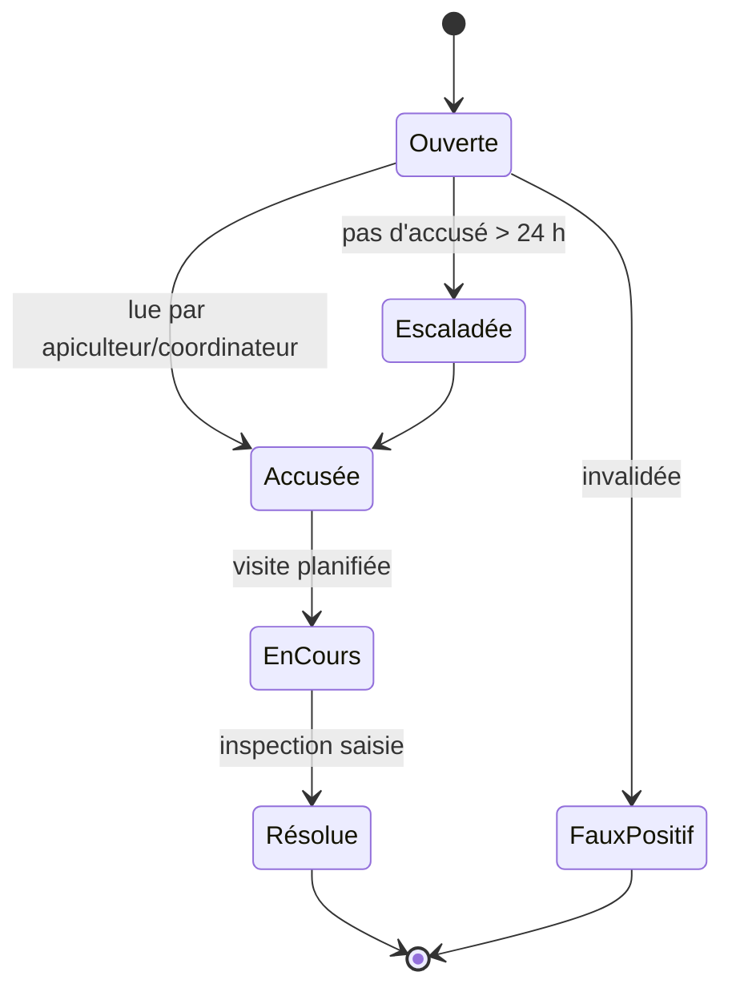

# États d'une alerte

**Question** : quels sont les états d'une alerte et quand passe-t-on de l'un à l'autre ?
**Source** : ROADMAP §4.8 (« États d'une alerte »). Les états correspondent à l'enum SQL `alert_status` : `open`, `acknowledged`, `in_progress`, `resolved`, `escalated`, `false_positive` (Ouverte, Accusée, EnCours, Résolue, Escaladée, FauxPositif).

