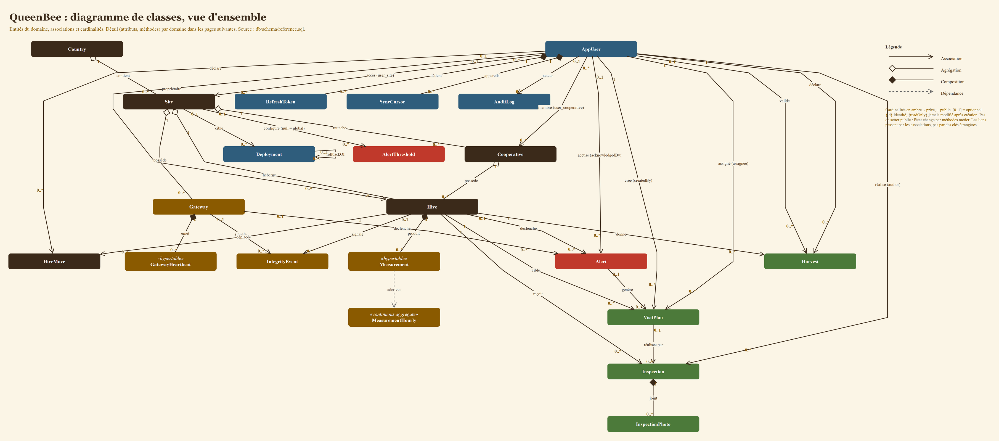
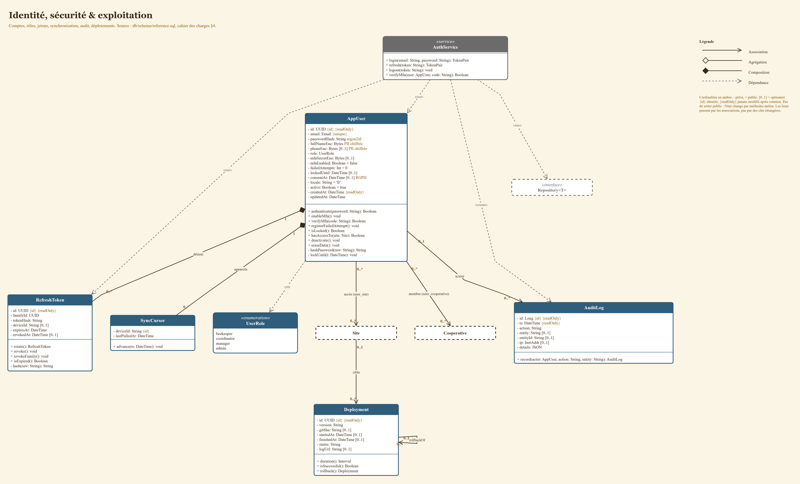
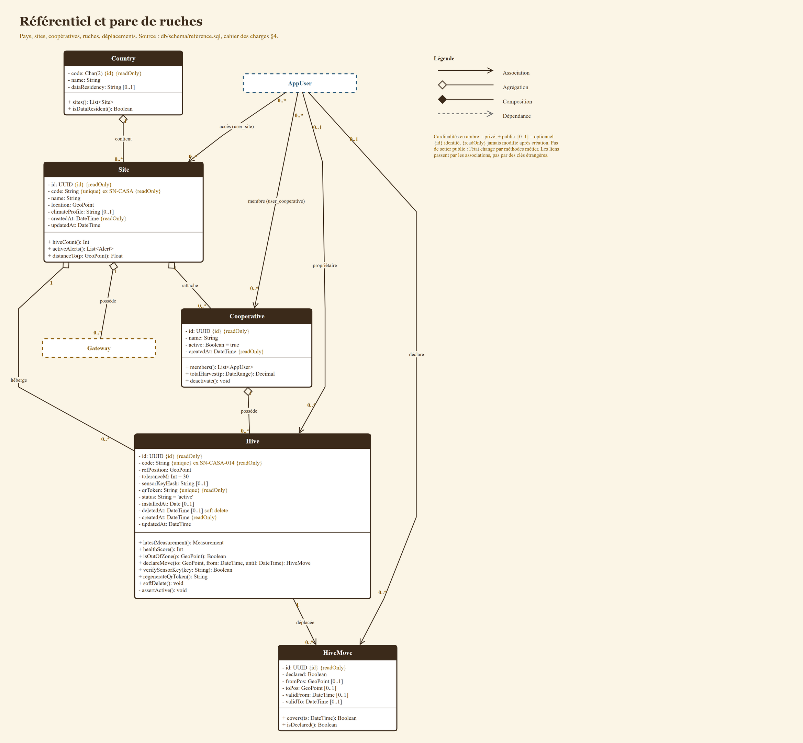
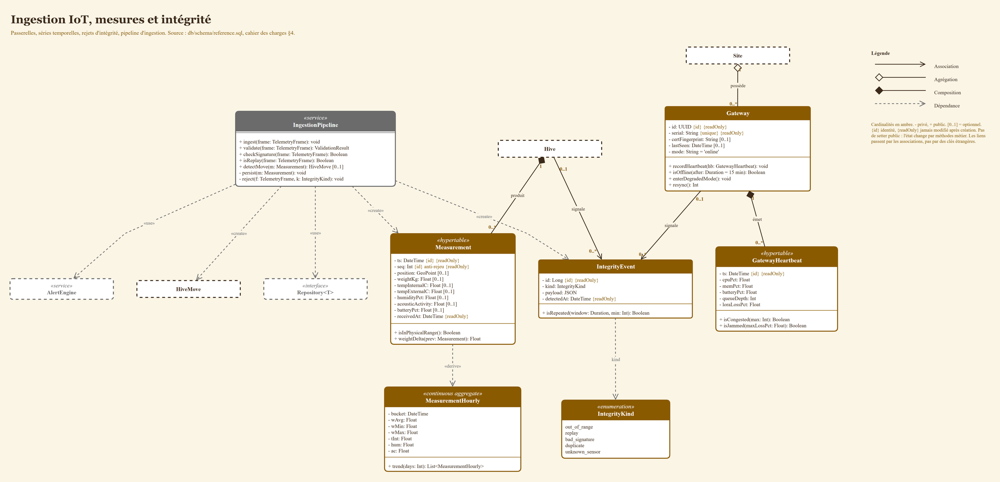
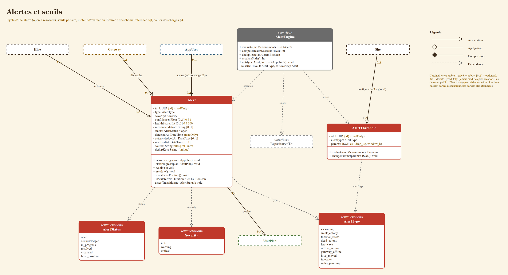
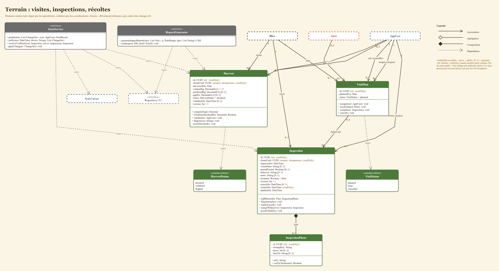

# Diagramme de classes

**Question** : quelles sont les classes du domaine QueenBee, quelles données et quels comportements portent-elles, et comment sont-elles reliées (cardinalités comprises) ?
**Source** : `db/schema/reference.sql` (DDL de référence, EP-02), `cahier de charge.md` §IV (comportements déduits des UC), ROADMAP §4.7 (palette) et §4.9 (modèle de données).
**Fichier éditable** : [`uml/class-diagram.drawio`](uml/class-diagram.drawio) (6 pages, ouvrir avec draw.io). Les PNG ci-dessous sont des exports.

## Lecture
- Une page « vue d'ensemble » (entités et cardinalités) puis une page de détail par domaine (attributs typés, méthodes, services).
- Boîte pleine = classe détaillée sur cette page. Boîte en pointillés = classe détaillée ailleurs, rappelée pour situer les relations.
- Couleurs : terre = référentiel, bleu = identité et exploitation, ambre = IoT, rouge = alertes, vert = terrain, gris = services.
- Notation : `-` privé, `+` public, `[0..1]` optionnel, `{id}` identité, `{readOnly}` jamais modifié après création, `{unique}` unicité.

## Principes d'encapsulation appliqués
1. **Attributs privés.** Aucun attribut public, aucun setter. L'état change par des méthodes métier (`Alert.acknowledge()`, `Harvest.validate()`, `AppUser.registerFailedAttempt()`), qui protègent les invariants.
2. **Invariants internes cachés.** Les gardes de transition sont privées (`Alert.assertTransition()`, `Inspection.assertEditable()`, `Harvest.assertDeclared()`).
3. **Liens par associations, pas par clés étrangères.** Les colonnes `*_id` du DDL n'apparaissent pas : `Hive` ne porte pas un `siteId`, il est relié à `Site`. La clé étrangère est un détail de persistance.
4. **Immutabilité.** `id`, `createdAt`, `clientUuid`, `ts`, `seq`, `detectedAt` sont `{readOnly}`. `AuditLog` n'expose aucune méthode de modification (append-only) ; `Measurement` n'a pas de mutateur.
5. **Données sensibles opaques.** `fullNameEnc`, `phoneEnc`, `mfaSecretEnc`, `passwordHash` sont privés et jamais renvoyés par une méthode publique.
6. **Composition = cycle de vie lié.** `RefreshToken`, `SyncCursor`, `Measurement`, `GatewayHeartbeat`, `InspectionPhoto` n'existent pas sans leur parent (losange plein).
7. **Navigabilité unidirectionnelle** (flèche ouverte) : pas de couplage bidirectionnel par défaut.
8. **Services dépendants d'une abstraction.** `AuthService`, `IngestionPipeline`, `AlertEngine`, `SyncService`, `ReportGenerator` dépendent de l'interface `Repository<T>` (inversion de dépendance, couches `routers / services / repositories` du CLAUDE.md), pas d'une implémentation SQLAlchemy.
9. **Tell, don't ask.** Les règles vivent dans l'objet qui détient la donnée (`Hive.isOutOfZone()`, `Gateway.isOffline()`, `Harvest.isOutlier()`), pas dans les appelants.

## Vue d'ensemble

## Identité, sécurité et exploitation

## Référentiel et parc de ruches

## Ingestion IoT, mesures et intégrité

## Alertes et seuils

## Terrain : visites, inspections, récoltes

## Écarts et hypothèses à valider
- **`Alert` / `VisitPlan`** : le DDL autorise plusieurs plans de visite par alerte (`0..1` vers `0..*`), alors que `er.md` dit `0..1` vers `0..1`. Le diagramme suit le DDL. À trancher en revue.
- **Services et méthodes** : les signatures des services et des méthodes métier sont une proposition déduite des UC. Elles ne sont pas encore dans le code (`apps/api`). À aligner sur l'implémentation réelle.
- **`MeasurementHourly`** est un agrégat continu TimescaleDB : lecture seule, aucun constructeur métier.
- Fréquence de mesure : voir l'incohérence I2 du cahier des charges (15 min retenu).
- Mettre à jour ce diagramme dans la même PR que toute migration qui change le modèle.
