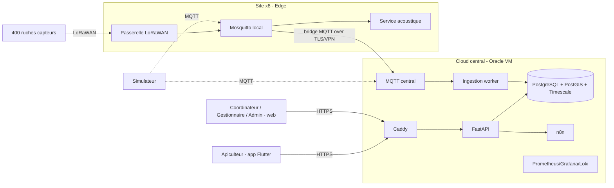

# Diagramme de contexte système

**Question** : qui interagit avec QueenBee et quels sont les grands blocs ?
**Source** : ROADMAP §4.8 (« Contexte système »). **Légende** : trait plein = flux de production ; pointillé = simulateur (tests/démo).

