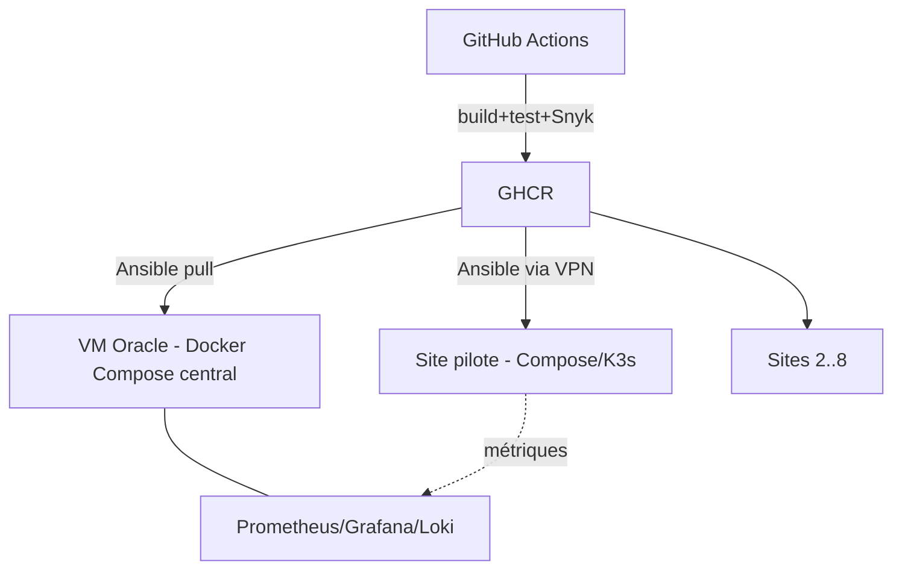

# Déploiement

**Question** : comment le code passe-t-il de GitHub aux serveurs centraux et aux 8 sites ?
**Source** : ROADMAP §4.8 (« Déploiement »). Pipeline détaillé : ROADMAP §5.3. Chaque déploiement écrit dans la table `deployment` (KPI > 95 % de réussite).

