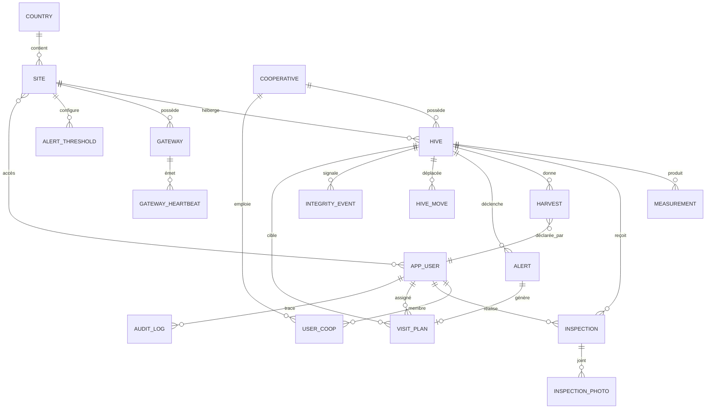

# Modèle conceptuel de données (MCD)

**Question** : quelles sont les entités de QueenBee et comment sont-elles reliées ?
**Source** : ROADMAP §4.9 (« MCD »). Le DDL complet (types, contraintes, hypertables, RLS) est dans `db/schema.sql` ; les colonnes sont décrites dans `docs/data-dictionary.md`. Principes : UUID, `timestamptz` UTC, soft delete, `created_at/updated_at/version`, audit trail, RLS par site, PII chiffrée.

