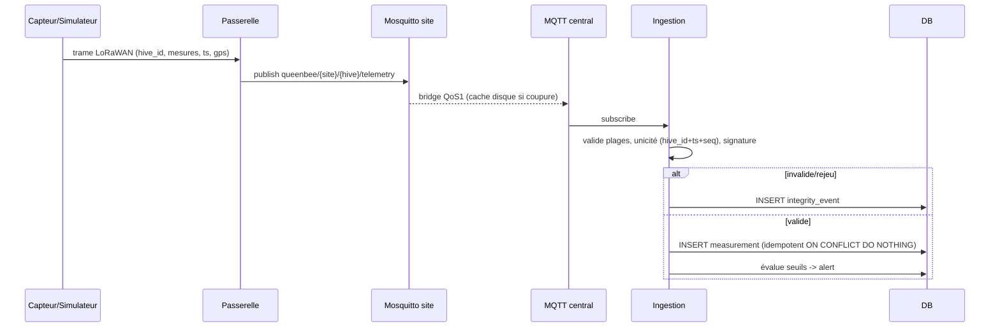

# Séquence - ingestion IoT (UC-T02)

**Question** : que devient une mesure de capteur, de la ruche à la base, y compris en cas de trame invalide ou rejouée ?
**Source** : ROADMAP §4.8 (« Séquence - ingestion IoT »). Voir aussi ADR-0002 (bridge MQTT) et `apps/ingest/`.

