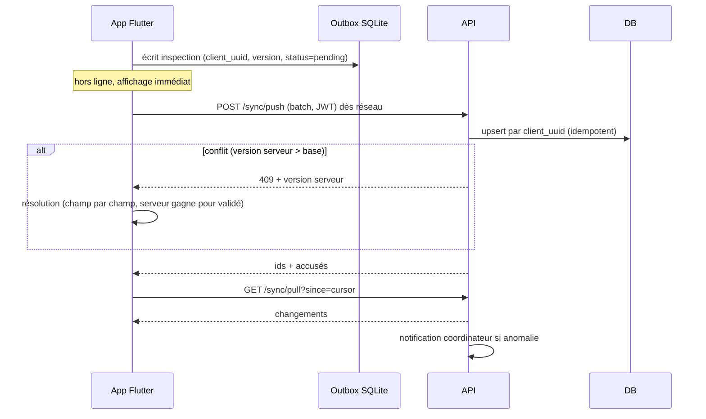

# Séquence - synchronisation hors ligne (UC-A01)

**Question** : comment une inspection saisie sans réseau arrive-t-elle sur le serveur sans doublon, et comment les conflits sont-ils traités ?
**Source** : ROADMAP §4.8 (« Séquence - sync offline »). Voir ADR-0003 et `apps/mobile/lib/core/sync/`.

