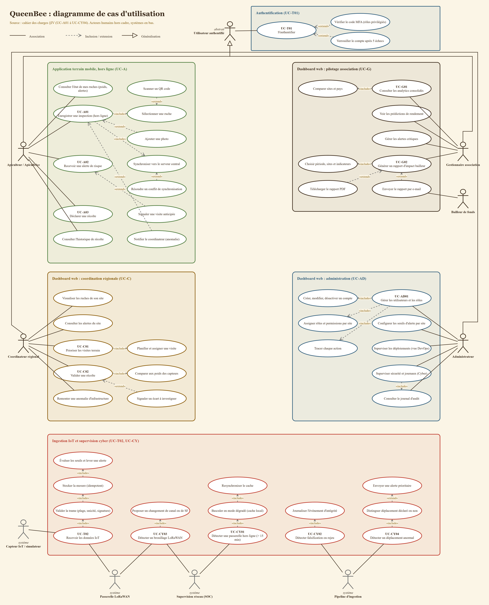

# Diagramme de cas d'utilisation

**Question** : qui fait quoi avec QueenBee, et quels cas d'utilisation en déclenchent d'autres ?
**Source** : `cahier de charge.md` §IV (UC-A01 à UC-CY04) et §III (profils). Les cas sans code (par exemple « Scanner un QR code ») sont des étapes ou variantes tirées des scénarios de ces UC.
**Fichier éditable** : [`uml/use-case-diagram.drawio`](uml/use-case-diagram.drawio) (ouvrir avec draw.io). Le PNG ci-dessous est un export.

## Lecture
- **Acteurs humains** sur les côtés : apiculteur/trice, coordinateur régional, gestionnaire, administrateur, plus le bailleur de fonds (destinataire du rapport).
- **Acteurs système** en bas (gris) : capteur ou simulateur, passerelle LoRaWAN, supervision réseau (SOC), pipeline d'ingestion.
- **Utilisateur authentifié** (acteur abstrait) : les quatre rôles en héritent (généralisation) et partagent UC-T01. Le MFA est une extension réservée aux rôles privilégiés ; le verrouillage après 5 échecs est une extension de l'échec d'authentification.
- **`«include»`** : le cas de base ne fonctionne pas sans le cas inclus (UC-A01 inclut la sélection d'une ruche et la synchronisation). **`«extend»`** : variante optionnelle, avec condition (photo, conflit de synchronisation, anomalie signalée, écart de récolte).
- Cadres colorés = sous-systèmes : application mobile hors ligne (vert), dashboard coordination (ambre), pilotage (terre), administration (bleu), ingestion et cyber (rouge).

## Correspondance avec le cahier des charges
| UC | Acteur principal | Sous-système |
|---|---|---|
| UC-A01 Inspection hors ligne | Apiculteur | Application terrain |
| UC-A02 Alerte de risque | Apiculteur | Application terrain |
| UC-A03 Déclaration de récolte | Apiculteur | Application terrain |
| UC-C01 Priorisation des visites | Coordinateur | Coordination |
| UC-C02 Validation d'une récolte | Coordinateur | Coordination |
| UC-G01 Analytics consolidés | Gestionnaire | Pilotage |
| UC-G02 Rapport d'impact bailleur | Gestionnaire (bailleur destinataire) | Pilotage |
| UC-AD01 Utilisateurs et rôles | Administrateur | Administration |
| UC-T01 Authentification et sync sécurisée | Tous les rôles | Authentification |
| UC-T02 Données IoT | Capteur, passerelle | Ingestion |
| UC-CY01 Passerelle hors ligne | Supervision réseau | Ingestion et cyber |
| UC-CY02 Falsification ou rejeu | Pipeline d'ingestion | Ingestion et cyber |
| UC-CY03 Brouillage LoRaWAN | Passerelle, supervision réseau | Ingestion et cyber |
| UC-CY04 Déplacement anormal | Pipeline d'ingestion | Ingestion et cyber |

## Hypothèses et limites
- Les besoins des profils (§3.2) sans UC numéroté (consulter l'état de mes ruches, historique de récolte, alertes du site, seuils d'alerte, vues DevOps et Cyber, journal d'audit) sont ajoutés comme cas simples, rattachés au bon acteur.
- Le déclenchement de UC-A02 par la détection d'alertes (« Évaluer les seuils et lever une alerte ») n'est pas tracé par une flèche entre sous-systèmes, pour la lisibilité. Voir `ingest-sequence.md` et `alert-states.md`.
- UC-T02 : fréquence de 15 min retenue (incohérence I2 du cahier des charges).
- Mettre à jour ce diagramme dans la même PR que tout changement de périmètre fonctionnel.
